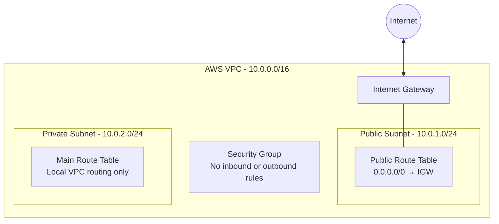

# Personal DevOps Lab

A hands-on cloud engineering and DevOps portfolio project built using AWS, Terraform, Git, and GitHub.

## Project Overview

The Personal DevOps Lab is a practical learning and portfolio project designed to demonstrate infrastructure as code (IaC), cloud networking, version control, and automation practices using Amazon Web Services (AWS).

The project is being developed incrementally, with an emphasis on repeatability, security, cost awareness, and sound engineering practices.

## Current Status

**Phase 1: Terraform AWS Network Foundation**

- [x] AWS account and IAM user configured
- [x] Terraform installed and initialized
- [x] AWS provider configured
- [x] VPC and subnet configuration defined
- [x] Internet Gateway and public routing defined
- [x] Security group defined
- [x] Terraform configuration validated
- [x] Execution plan generated and reviewed
- [x] Git repository created and published to GitHub

**Important:** The Terraform infrastructure has been validated and planned but has not yet been deployed to AWS.

## Technology Stack

- Amazon Web Services (AWS)
- Terraform
- Git
- GitHub
- Visual Studio Code
- PowerShell


## AWS Infrastructure Design

### Network Architecture




The initial infrastructure foundation defines the following AWS resources in the `us-east-2` (Ohio) region.

| Resource | Terraform Resource | Purpose |
|---|---|---|
| Virtual Private Cloud | `aws_vpc` | Provides an isolated network environment |
| Public Subnet | `aws_subnet` | Hosts resources that may require internet connectivity |
| Private Subnet | `aws_subnet` | Provides a subnet without direct internet routing |
| Internet Gateway | `aws_internet_gateway` | Provides internet connectivity for the public subnet |
| Public Route Table | `aws_route_table` | Defines the public subnet's default internet route |
| Route Table Association | `aws_route_table_association` | Associates the public subnet with its route table |
| Security Group | `aws_security_group` | Defines network traffic access controls |

### Network Addressing

| Component | CIDR Block |
|---|---|
| VPC | `10.0.0.0/16` |
| Public Subnet | `10.0.1.0/24` |
| Private Subnet | `10.0.2.0/24` |

Both subnets are currently configured in Availability Zone `us-east-2a`.

### Networking and Security Decisions

- The public subnet is configured to assign public IPv4 addresses to instances launched within it.
- The private subnet has no direct internet route.
- No NAT Gateway is configured, avoiding its ongoing hourly and data-processing costs.
- The security group currently has no explicitly configured inbound or outbound rules.
- AWS credentials are managed outside the Terraform configuration.


## Repository Structure

```text
Personal-DevOps-Lab/
│
├── .gitignore
├── README.md
│
└── terraform/
    ├── .terraform.lock.hcl
    ├── main.tf
    ├── outputs.tf
    └── versions.tf
```

## Terraform Workflow

The project follows a standard Terraform workflow:

1. `terraform init` — Initialize the working directory and download providers.
2. `terraform fmt` — Format Terraform configuration files.
3. `terraform validate` — Check configuration syntax and consistency.
4. `terraform plan` — Preview proposed infrastructure changes.
5. `terraform apply` — Deploy infrastructure after reviewing and approving the plan.

Infrastructure deployment is intentionally controlled to minimize unexpected AWS costs.

## Cost Management

Cost awareness is a core design consideration.

- AWS region restricted to `us-east-2` in the initial IAM policy.
- No NAT Gateway or unnecessary compute resources in the initial network foundation.
- AWS budget notifications configured.
- Infrastructure changes reviewed before deployment.
- Terraform state and saved plans excluded from Git.

## Planned Development

Future phases will expand the lab incrementally:

- [ ] Deploy and verify the initial AWS network foundation.
- [ ] Add compute infrastructure using EC2.
- [ ] Introduce remote Terraform state management.
- [ ] Build CI/CD automation using GitHub Actions.
- [ ] Develop Python-based AWS monitoring tools.
- [ ] Explore Docker and Kubernetes.
- [ ] Document architecture, deployment, and operational procedures.

---

## Author

**adaniel67**

GitHub: [github.com/adaniel67](https://github.com/adaniel67)
