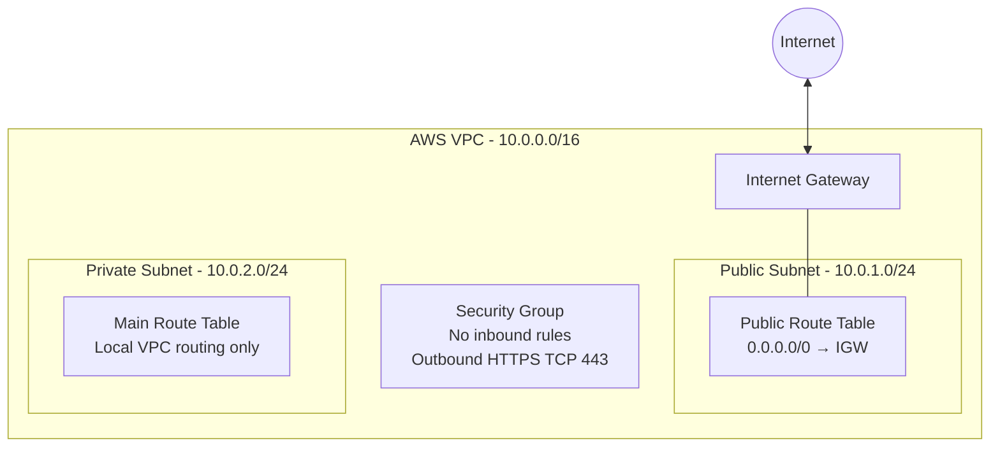
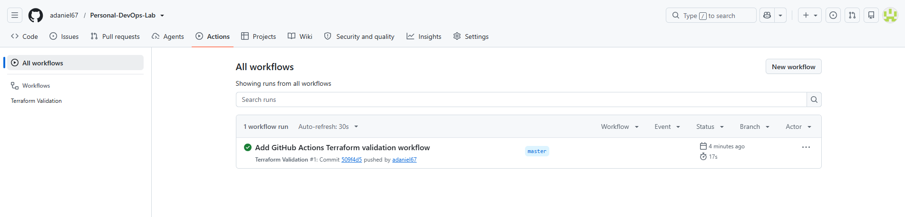
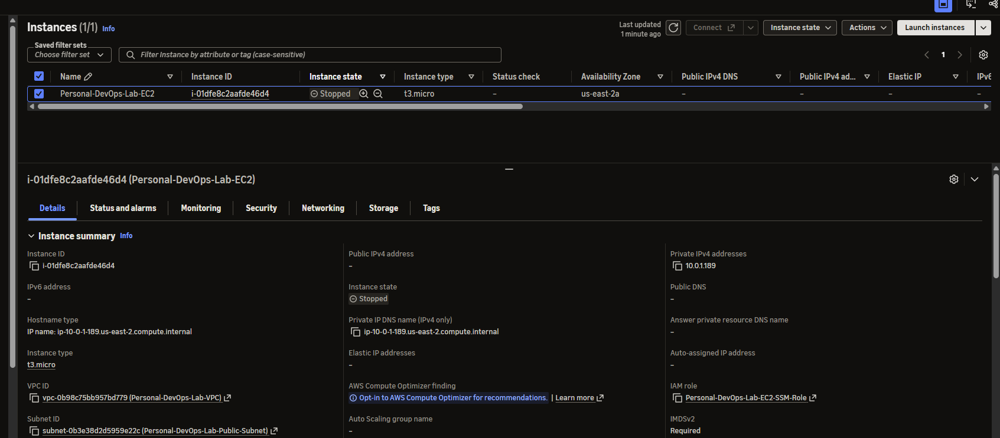
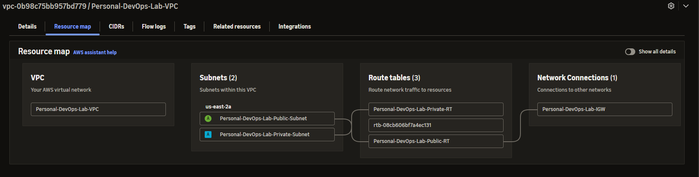

# Personal DevOps Lab

A hands-on cloud engineering and DevOps portfolio project built using AWS, Terraform, Git, and GitHub.

## Project Overview

The Personal DevOps Lab is a practical learning and portfolio project designed to demonstrate infrastructure as code (IaC), cloud networking, version control, and automation practices using Amazon Web Services (AWS).

The project is being developed incrementally, with an emphasis on repeatability, security, cost awareness, and sound engineering practices.

## Current Status

**Phase 1: AWS Infrastructure Foundation — Complete**

- [x] AWS account and IAM configured
- [x] Terraform configuration created and validated
- [x] VPC, public and private subnets deployed
- [x] Internet Gateway and route tables deployed
- [x] Security group configured
- [x] EC2 instance deployed
- [x] IAM role and Systems Manager access configured
- [x] EC2 access verified through SSM Session Manager
- [x] AWS CLI start/stop workflow tested
- [x] GitHub Actions Terraform validation workflow implemented
- [x] Architecture diagram and project documentation published

**Current State:** Infrastructure is deployed in AWS `us-east-2`. The EC2 instance is currently stopped.

## Technology Stack

- Amazon Web Services (AWS)
- Terraform
- Git
- GitHub
- Visual Studio Code
- PowerShell


## AWS Infrastructure Design

### Network Architecture




The initial infrastructure foundation defines the following AWS resources in the `us-east-2` (Ohio) region.

| Resource | Terraform Resource | Purpose |
|---|---|---|
| Virtual Private Cloud | `aws_vpc` | Provides an isolated network environment |
| Public Subnet | `aws_subnet` | Hosts resources that may require internet connectivity |
| Private Subnet | `aws_subnet` | Provides a subnet without direct internet routing |
| Internet Gateway | `aws_internet_gateway` | Provides internet connectivity for the public subnet |
| Public Route Table | `aws_route_table` | Defines the public subnet's default internet route |
| Route Table Association | `aws_route_table_association` | Associates the public subnet with its route table |
| Security Group | `aws_security_group` | Defines network traffic access controls |

### Network Addressing

| Component | CIDR Block |
|---|---|
| VPC | `10.0.0.0/16` |
| Public Subnet | `10.0.1.0/24` |
| Private Subnet | `10.0.2.0/24` |

Both subnets are currently configured in Availability Zone `us-east-2a`.

### Networking and Security Decisions

- The public subnet is configured to assign public IPv4 addresses to instances launched within it.
- The private subnet has no direct internet route.
- No NAT Gateway is configured, avoiding its ongoing hourly and data-processing costs.
- **Security Group:** No inbound rules; outbound TCP 443 (HTTPS) only.
- AWS credentials are managed outside the Terraform configuration.


## Repository Structure

```text
Personal-DevOps-Lab/
├── .github/
│   └── workflows/
│       └── terraform.yml
├── screenshots/
│   ├── github-actions-success.png
│   ├── ec2-instance.png
│   └── vpc-architecture.png
├── .gitignore
├── README.md
└── terraform/
    ├── .terraform.lock.hcl
    ├── ec2.tf
    ├── iam.tf
    ├── main.tf
    ├── outputs.tf
    ├── variables.tf
    └── versions.tf
```

## Terraform Workflow

The project uses Terraform to manage AWS infrastructure and GitHub Actions to automatically check configuration quality.

**Manual Terraform Workflow:**

1. `terraform init` — Initialize the working directory and download providers.
2. `terraform fmt` — Format Terraform configuration files.
3. `terraform validate` — Check configuration syntax and consistency.
4. `terraform plan` — Preview proposed infrastructure changes before deployment.
5. `terraform apply` — Deploy infrastructure only after reviewing the complete plan and explicitly approving deployment.

**Automated GitHub Actions Workflow:**

The GitHub Actions workflow runs automatically when code is pushed to the `master` branch or a pull request targets `master`.

It performs three checks:

1. Terraform formatting (`terraform fmt -check -recursive`).
2. Terraform initialization (`terraform init -backend=false`).
3. Terraform validation (`terraform validate`).

This automation helps catch formatting and configuration errors before changes are merged.

Infrastructure deployment remains manually controlled. GitHub Actions does not run `terraform apply`.

## Cost Management

Cost awareness is a core design consideration.

- AWS region restricted to `us-east-2`.
- No NAT Gateway or unnecessary networking resources deployed.
- One EC2 `t3.micro` instance with an 8 GB gp3 root volume.
- EC2 instance can be stopped when not in use.
- AWS monthly budget configured at $10, with actual and forecasted spending notifications.
- Budget notifications provide alerts only; they do not automatically stop AWS spending.
- Infrastructure changes reviewed before deployment.
- Terraform state and saved plans excluded from Git.

## Planned Development

Future phases will expand the lab incrementally:

- [x] Deploy and verify the initial AWS network foundation.
- [x] Deploy EC2 compute infrastructure.
- [x] Configure IAM permissions, security groups, and Systems Manager access.
- [x] Implement GitHub Actions Terraform formatting and validation.
- [x] Document architecture, deployment, and operational procedures.
- [ ] Review and further harden IAM permissions and network access controls.
- [ ] Introduce remote Terraform state management.
- [ ] Develop Python-based AWS monitoring tools.
- [ ] Explore Docker and Kubernetes.

---

## Author

**adaniel67**

GitHub: [github.com/adaniel67](https://github.com/adaniel67)

## Deployed Infrastructure

The Terraform configuration provisions the following AWS resources in `us-east-2`:

- **VPC:** `10.0.0.0/16`
- **Public subnet:** `10.0.1.0/24`
- **Private subnet:** `10.0.2.0/24`
- **Internet Gateway** and public route table
- **Private route table** for the private subnet
- **Security group:** No inbound rules; outbound HTTPS (TCP 443) only
- **EC2 instance:** Amazon Linux 2023, `t3.micro`, with an 8 GB gp3 root volume
- **IAM role and instance profile:** Attached to EC2 for Systems Manager access

### Instance Management

The EC2 instance is managed through AWS Systems Manager Session Manager. SSH access and inbound port 22 are not required.

The instance can be stopped when not in use and started again when needed. Terraform lifecycle configuration ignores changes to the automatically assigned public IP address so that stopping the instance does not trigger an unnecessary replacement.

### Connecting to the EC2 Instance

The instance is accessed through AWS Systems Manager Session Manager. No SSH key or inbound SSH rule is required.

To connect:

1. Sign in to the AWS Management Console.
2. Set the AWS Region to **US East (Ohio) – `us-east-2`**.
3. Open **EC2 → Instances**.
4. Select `Personal-DevOps-Lab-EC2`.
5. Choose **Connect**.
6. Open the **Session Manager** tab.
7. Select **Connect**.

A browser-based terminal opens when the connection succeeds.

The instance must be running, and its Systems Manager status must be Online.

### Starting and Stopping the EC2 Instance with AWS CLI

The EC2 instance can be managed from PowerShell using the AWS CLI.

**Start the instance:**

```powershell
aws ec2 start-instances --instance-ids i-01dfe8c2aafde46d4

## Screenshots

### GitHub Actions Validation



### EC2 Instance



### VPC Architecture

